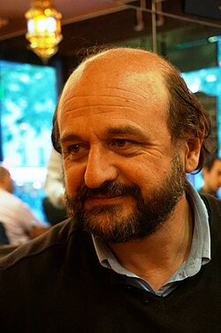
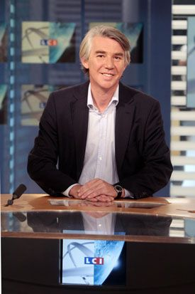

Jean Marc Jancovici 

.jpg)

Jean-Marc Jancovici, né le 13 février 1962 à Paris. Fils de Bernard Jancovici, qui est un physicien qui était à l'[université Paris-Sud](https://fr.wikipedia.org/wiki/Universit%C3%A9_Paris-Sud)
Il fut étudiant à grenoble en premier lieu. Son père est nommé à un poste de professeur, il suit l'enseignement de mathématiques spéciales au lycée Louis-le-Grand. Il est diplômé de l'École polytechnique 
et ingénieur civil de l'École nationale supérieure des télécommunications. Avec l'acteur Franck Cabot-David et monte avec lui la société Ciné Magma production où il y restera jusqu'en 1989. 

Après avoir été au Ciné Magma, il commença à s'intéresser au réchauffement climatique et grâce à cela il développa le célèbre "bilan carbone" pour les professionnels et les entreprises. Grâce 
Benjamin Dessus il a pu travaillé pour l'Ademe et entre 2000 et 2004, il créa la méthode de carbone personnel cette fois-ci.

En 2006, il cofonde les Entretiens de Combloux avec  Hervé Le Treut( à gauche ) et Jean-Louis Caffier( à droite) pour former des dirigeants de rédactions aux enjeux climatiques et énergétiques.
Ce séminaire accueille de grandes figures du journalisme français jusqu'en 2014. Vous pouvez consulter les détails de sa biographie en ligne.

 

En 2007, il fonda le carbone 4, un cabinet des avocats qui vendent des bilans carbone et des plans pour réduire leurs émissions de gaz à effets de serre. En fait c'est même le premier cabinet de ce genre,
c'est le premier cabinet de stratégie carbone.

Depuis 2008, il travaille en tant que enseignant dans le supérieur à  [l’École nationale supérieure des mines de Paris](https://fr.wikipedia.org/wiki/%C3%89cole_nationale_sup%C3%A9rieure_des_mines_de_Paris)
où il parle de changement climatiaque avec ces élèves.

En tant que personnage public, Jean Marc Jancovici est souvent dénoncer pour des prises de position jugés problématiques comme sur la minimisations du nucléaire avec des accidents tels que Tchernobyle ou Fukushima.
Les associations Sortir du nucléaire ou le média Reporterre dénonce aussi sa prise de position sur la gestion des déchets radioactifs après la fission nucléaire. Il affirme régulièrement que l'éolien et le solaire 
ne peuvent pas remplacer le nucléaire en raison de leur irrégularité. Il est accusé de faire des calculs faussés (notamment sur le nombre d'éolienne qu'ils faudraient pour alimenter la France) pour ainsi dénigrer
les autres énergies renouvelables et faire passer sa vision des choses. Et enfin, plusieurs collectifs de chercheurs et spécialistes de l'énergie ont pointé du doigt des approximations majeures dans la bande 
dessinée Le Monde sans fin, notamment concernant le coût et l'emprise spatiale des énergies renouvelables. De plus, la posture de Jean-Marc Jancovici agace une partie de la communauté scientifique en raison de
l'utilisation abusive des lois de la physique et d'un traitement parfois professoral de ses contradicteurs.
